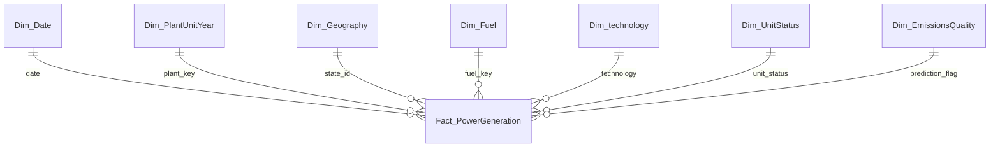

# Indian Power Plant Performance, Reliability & Emissions Analytics

A 5-page Power BI dashboard that analyzes daily generation, capacity and CO₂ emissions of Indian power plants from April 2018 to October 2025.

## Project Overview

Generation, plant utilization and emissions are usually studied separately, which makes it hard to compare states, zones and fuels in one place. This project brings them together in one interactive report so that decision makers can see where electricity comes from, how well plants use their capacity, and where emissions are highest.

**Objectives**
- Track generation trends over 8 fiscal years
- Compare states, zones, technologies and fuels
- Measure capacity utilization (capacity factor)
- Measure total emissions and emission intensity
- Provide one interactive view for analysis

## Dataset

**CHETNA-Power Plants: Unit-Level Inventory with Daily Generation and CO₂ Emissions for India (2018–2025)** (Zhou et al., Zenodo, version 2, CC BY 4.0)

- Link: https://zenodo.org/records/19709141
- DOI: 10.5281/zenodo.19709141
- Two CSV files: daily plant-unit records (generation and emissions) and a plant inventory (capacity, location, fuel)
- Period used: 1 Apr 2018 to 4 Oct 2025

The dataset is not included in this repository because of its size. Download it from the link above.

## Tools Used

Power BI Desktop, Power Query (M), DAX

## Data Cleaning and Transformation

Done in Power Query:
- Changed data types (emissions and capacity to decimal, years to whole number)
- Trimmed and cleaned text columns and renamed columns
- Removed duplicates to build each dimension table
- Removed blank rows and unused columns
- Built a composite key (`PlantUnitYear_Key` = fiscal year | plant | unit) to join the inventory to the daily data
- Created a fuel key and set missing fuel values to **Unknown**
- Built a date table from the distinct dates in the data

**Double counting issue**

The source holds a plant-total record (`unit = 0`) and separate unit-level records (`unit > 0`) for the same plants. Adding both counted the same electricity twice:

| Records used | Total actual generation |
|---|---|
| Plant-total (`unit = 0`) | 10,451,407 GWh |
| Unit-level (`unit > 0`) | 9,019,954 GWh |
| Both together (incorrect) | 19,471,361 GWh |

All 532 plants have a plant-total record, so I kept only the `unit = 0` records in the fact table and in `Dim_PlantUnitYear`.

## Data Model

Star schema with one fact table (about 1.34M rows) and seven dimension tables. All relationships are many-to-one with single-direction filtering. `TOP_NO` is a separate table with no relationships; it feeds the Top N slicer.

## DAX Measures

27 measures are stored in one calculation table. The main ones:

| Measure | Purpose | Logic (simplified) |
|---|---|---|
| Total_actual_generation | Total gross generation | `SUM(Actual_Generation_GWh)` |
| emissions_per_gwh | Emission intensity | `DIVIDE(Total_emissions, Total_actual_generation)` |
| capacity_factor | Share of possible output actually generated | `DIVIDE(Generation * 1000, SUMX(Fact, RELATED(installed_capacity_mw)) * 24)` |
| yoy_generation_growth | Year-over-year growth | time intelligence with `SAMEPERIODLASTYEAR` |
| Number_of_Plant | Distinct plants | `DISTINCTCOUNT(plant_name)` |
| Emissions per plant | Average emissions per plant | `DIVIDE(Total_emissions, Number_of_Plant)` |
| Top Generating State | Name of the leading state | `TOPN` with `MAXX` |
| Top N measures | Show only the top N states | `RANKX` compared with the slicer value |

Generation is in GWh and capacity is in MW, so generation is multiplied by 1000 to convert it to MWh before dividing by capacity × 24 hours.

## Dashboard Pages

| Page | What it shows |
|---|---|
| Executive Overview | Total generation, net generation, emissions, number of plants, generation by fiscal year, technology, plant type and plant |
| Generation Trends & Analysis | YoY growth, average / highest / lowest daily generation, monthly and yearly trends, generation by fuel |
| Geographic Generation Intelligence | Generation by state (Top N slicer), emissions per GWh by zone, generation by zone and fuel, map |
| Plant, Fuel & Technology Intelligence | Capacity factor, installed capacity by plant, capacity factor by fuel, Decomposition Tree |
| Emissions Intelligence | Emissions per GWh, emissions per plant, emissions trend, top emitting states (Top N slicer), Key Influencers, emissions per GWh by fuel |

[Executive Overview] 
[Generation Trends]
[Geographic Generation]  
[Plant, Fuel & Technology]  
[Emissions Intelligence]  

**Interactivity:** slicers (fiscal year, state, zone, month, technology, prediction flag), a Top N slicer, page navigation buttons, cross-filtering, Key Influencers and Decomposition Tree.

## Key Findings

- Total actual generation is 10.45M GWh and net generation is 9.78M GWh (about 6.4% lower, because plants use part of their own output)
- Total emissions are 7.98 billion tonnes of CO₂ across 532 plants, or 763.9 tonnes per GWh
- Thermal plants supply 82.39% of generation, hydro 11.41% and nuclear 3.39%
- Uttar Pradesh, Chhattisgarh, Maharashtra and Madhya Pradesh are the top generating states
- Emissions per GWh are highest in the Western (838) and Eastern (832) zones and lowest in the North Eastern zone (423)
- Capacity factor is 48.14%, so plants run at about half of their capacity
- Generation peaks around May and is lowest in November; year-over-year growth is 15.78%

## Limitations

- Fuel and technology are recorded only at unit level. Because plant-level records were used, about 82% of generation has an Unknown fuel, so the fuel and technology charts cover only part of the data
- About 10.4% of rows have missing emissions values
- 2025 is a partial year (data ends on 4 Oct 2025), so its drop is not a real decline

## Author

**Adwaith S Nair**
LinkedIn: [linkedin.com/in/adwaithsnair](https://www.linkedin.com/in/adwaithsnair)
GitHub: [github.com/Adwaith-38](https://github.com/Adwaith-38)

## Data Credit

Data: Zhou et al., CHETNA-Power Plants dataset, Zenodo (CC BY 4.0).
